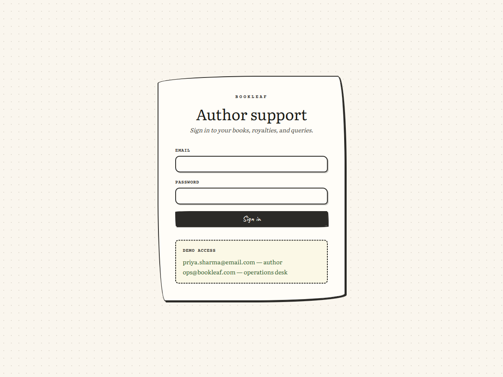
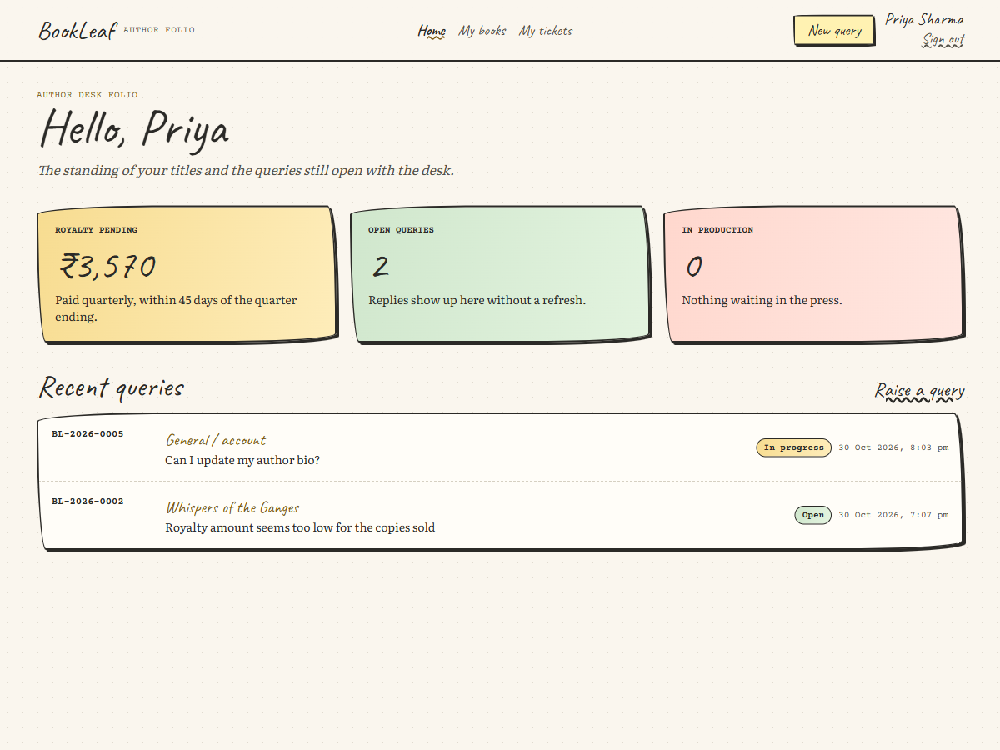
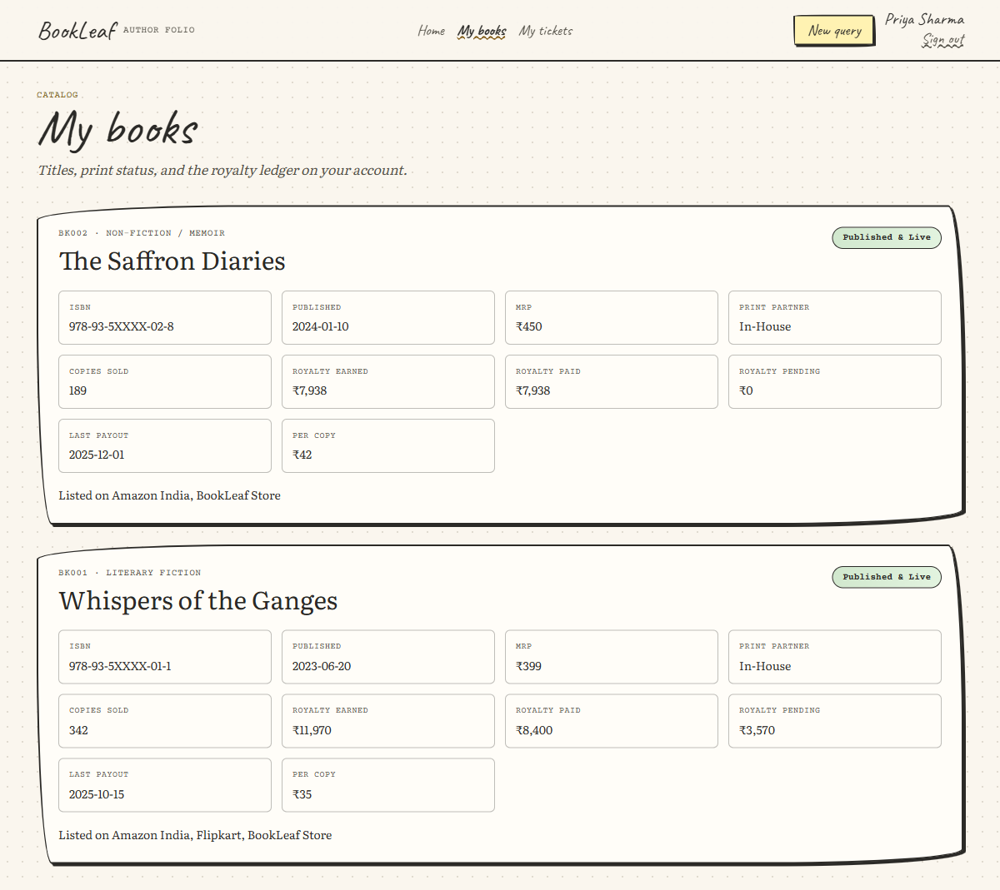
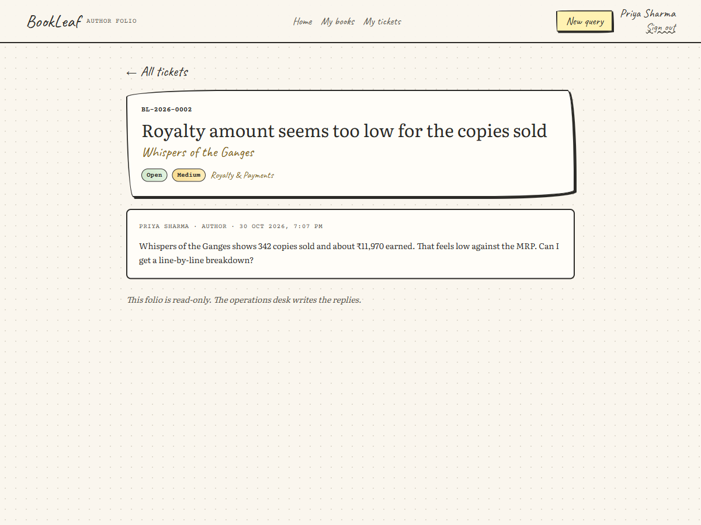
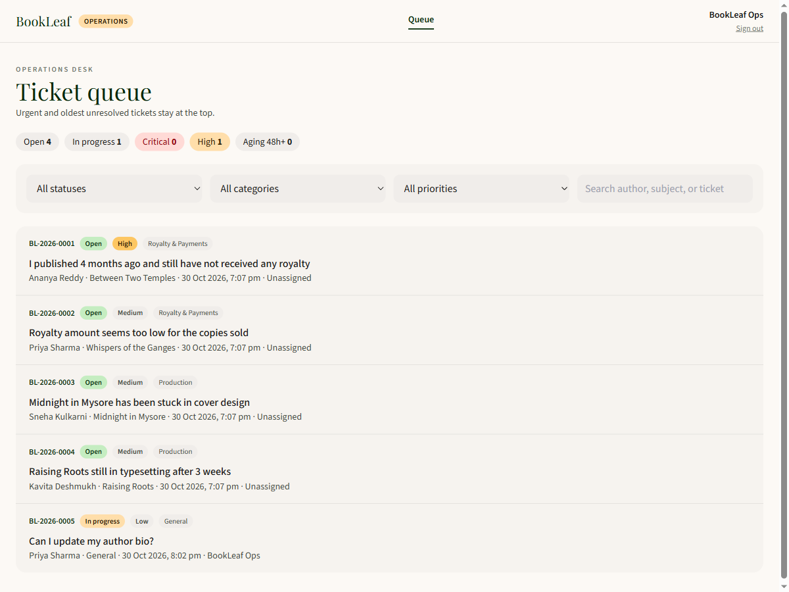
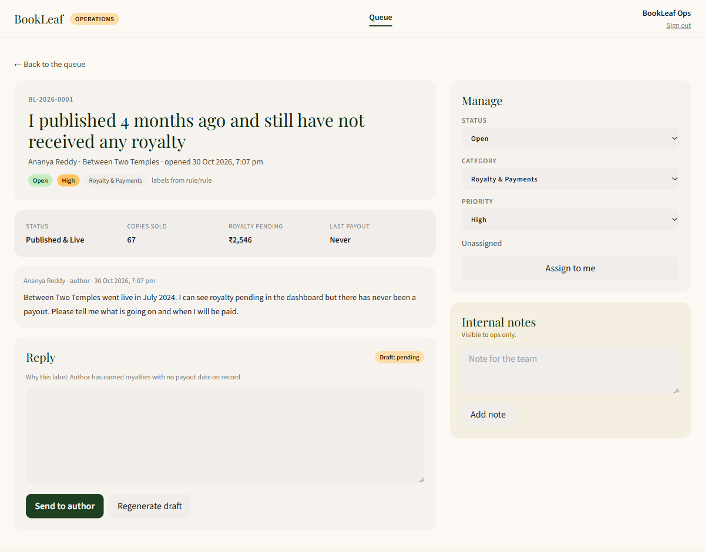

# BookLeaf Author Support Portal

Author and operations portal for BookLeaf Publishing. An author sees only their own books and queries. The operations desk sees the whole queue, can override the category and priority, edit a drafted reply, and send it. Internal notes never appear on the author thread.

Live portal: [https://bookleaf-portal-olive-eight.vercel.app](https://bookleaf-portal-olive-eight.vercel.app)

API docs: [https://bookleaf-api-fggj.onrender.com/docs](https://bookleaf-api-fggj.onrender.com/docs)

The API process has no page at `/`. Health is at `/health`.

## Demo accounts

Every seeded author uses `Author@123`. Operations uses `ops@bookleaf.com` / `Admin@123`.

| Account | What is on it |
|---|---|
| priya.sharma@email.com | Whispers of the Ganges, ₹3,570 pending, with a payout already recorded |
| ananya.reddy@email.com | Between Two Temples has earned royalty and has never been paid |
| arjun.malhotra@email.com | Turban Tales, the same never-paid case |
| kavita.deshmukh@email.com | Raising Roots still in typesetting; The Nagpur Notebooks pending ₹850, under the ₹1,000 line |
| sneha.kulkarni@email.com | Midnight in Mysore in cover design, with price and royalty blank |

Seeded tickets are `BL-2026-0001` through `BL-2026-0004`. The hosted database may also contain queries created after the seed.

## Author folio

The author side is a sketchbook: books, royalty standing, and a read-only query thread. Replies arrive on the open ticket without a manual refresh.









## Operations desk

The desk is a ledger. The queue sorts by priority, then by oldest open ticket. A ticket that stays open or in progress for more than 48 hours is marked aging. On a ticket, staff can edit the draft, regenerate it, send the reply, reassign status, category, and priority, and leave a note that authors cannot see.





## Behaviour

- Authors receive 404 for another author's book or ticket. The author payload never includes internal notes.
- A new query is saved before any model call. Classification and the draft run in the background, so a slow or missing model cannot block the author.
- Keyword rules label category and priority immediately. Groq (`openai/gpt-oss-120b`) may replace that label. The classify prompt does not include the knowledge base.
- The draft prompt receives the tone file, the matching category slice, and the book numbers from the database. Royalty answers follow BookLeaf policy: 80/20 of net profit, paid quarterly within 45 days of quarter end, with amounts under ₹1,000 rolling forward. The model is instructed not to invent payout dates or ISBN numbers.
- If the key is missing, the model errors, rate-limits, or times out, the rule labels stay and the draft is marked failed. Operations can still write the reply.
- Regenerate is an explicit action. Opening a ticket does not call the model again.
- Updates are pushed on a role-scoped event stream. Authors only receive events for their own account. If the stream drops, the page polls every 8 seconds.

## Stack

Next.js portal, FastAPI API, PostgreSQL. The hosted demo uses Vercel for the site, Render for the API, and Neon for Postgres. The free API sleeps after a quiet period and takes about a minute to wake; the portal keeps polling while it does.

## API

Routes are under `/api/v1`. Errors use `{ "error": { "code", "message", "details" } }`.

- `POST /auth/login`, `POST /auth/refresh`, `POST /auth/logout`, `GET /auth/me`
- `GET /books`, `GET /books/{id}`
- `POST /tickets`, `GET /tickets`, `GET /tickets/{id}`
- `GET /admin/stats`, `GET /admin/tickets`, `GET` and `PATCH /admin/tickets/{id}`
- `POST /admin/tickets/{id}/assign`, `/notes`, `/replies`, `/ai/regenerate-draft`
- `GET /events/stream` — bearer token required, so a browser `EventSource` cannot open it
- `GET /health`

## Local development

Requirements: Docker Desktop, Python 3.12, Node 20.

```powershell
docker compose up -d
cd backend
python -m venv .venv
.\.venv\Scripts\python.exe -m pip install -r requirements.txt
copy .env.example .env
.\.venv\Scripts\python.exe -m alembic upgrade head
.\.venv\Scripts\python.exe -m app.db.seed
.\.venv\Scripts\python.exe -m uvicorn app.main:app --port 8000
```

```powershell
cd frontend
copy .env.example .env.local
npm install
npm run dev
```

The portal is at http://localhost:3000. API docs are at http://localhost:8000/docs. Postgres is published on host port **5433**. A Groq key belongs in `backend/.env` as `GROQ_API_KEY`. Gemini is the backup (`AI_PROVIDER=gemini` and `GEMINI_API_KEY`). The API reads settings once at startup.

With the API running, from `backend`:

```powershell
.\.venv\Scripts\python.exe scripts\test_auth.py
.\.venv\Scripts\python.exe scripts\test_tickets.py
.\.venv\Scripts\python.exe scripts\test_ai.py
.\.venv\Scripts\python.exe scripts\test_realtime.py
```

## Hosted configuration

`render.yaml` migrates, seeds, and starts the API. `DATABASE_URL` accepts a normal `postgresql://` URL and rewrites it for the psycopg driver. `NEXT_PUBLIC_API_URL` is the API origin and is baked in when the site is built. `CORS_ORIGINS` is the site origin, with no trailing slash. `GROQ_API_KEY` and `JWT_SECRET` stay in the host environment.

## Limits

- A query can include attachment names. The files are not stored.
- The event stream lives in the API process. A second worker would not see the other worker's events.
- The example `JWT_SECRET` is for local use. A shared deploy needs its own secret.
